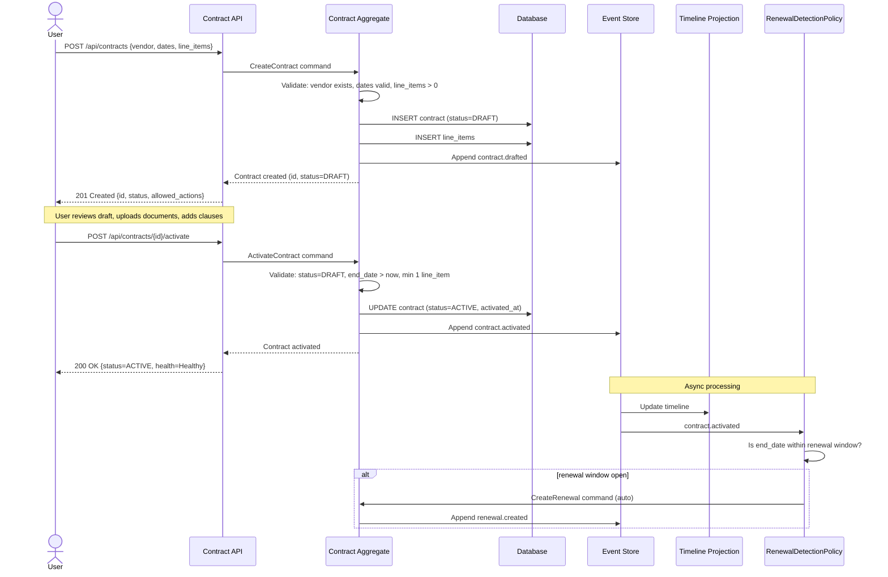
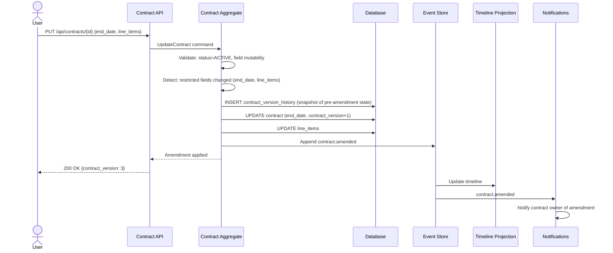
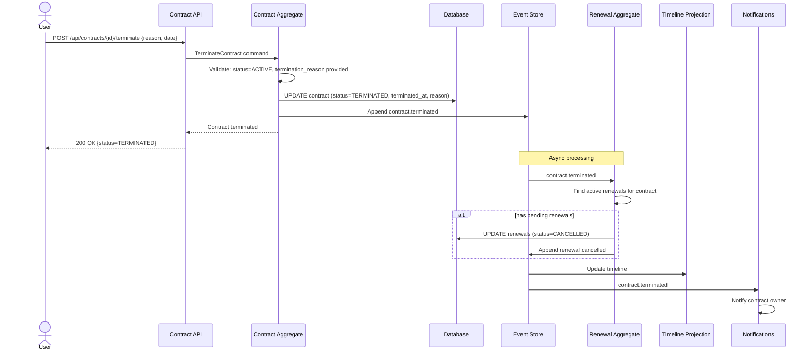
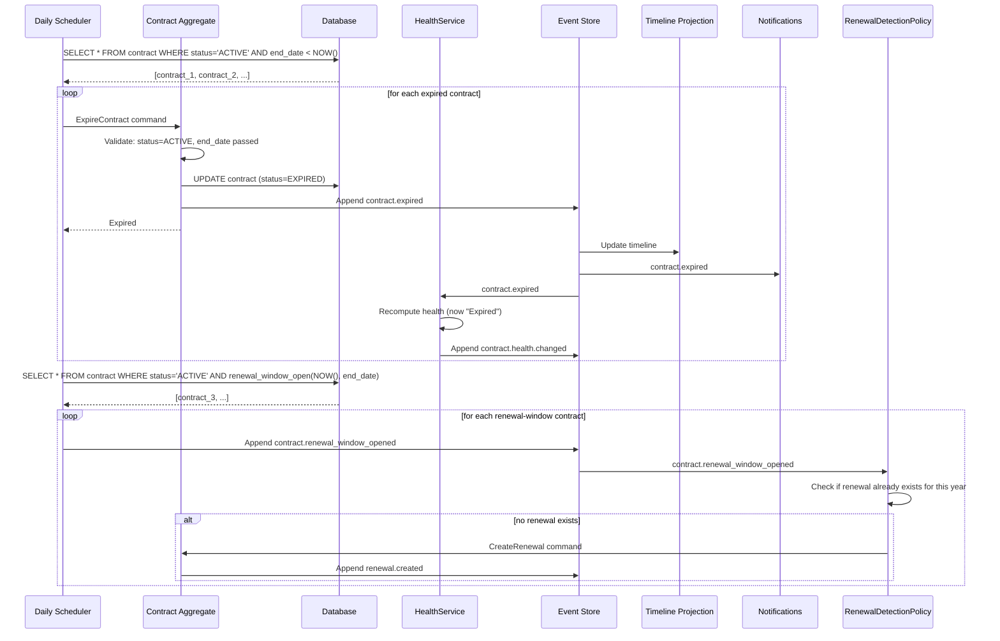
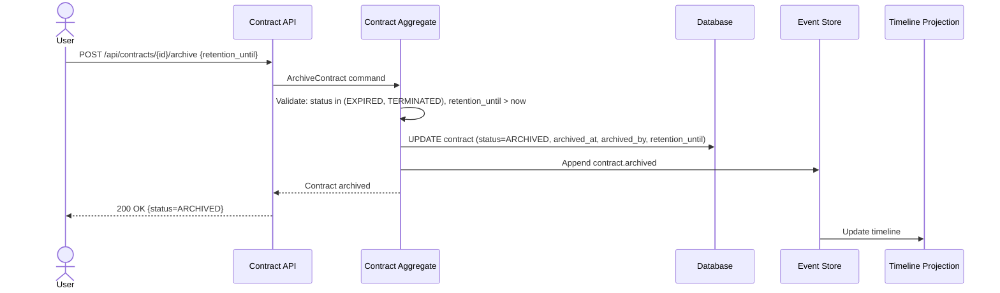
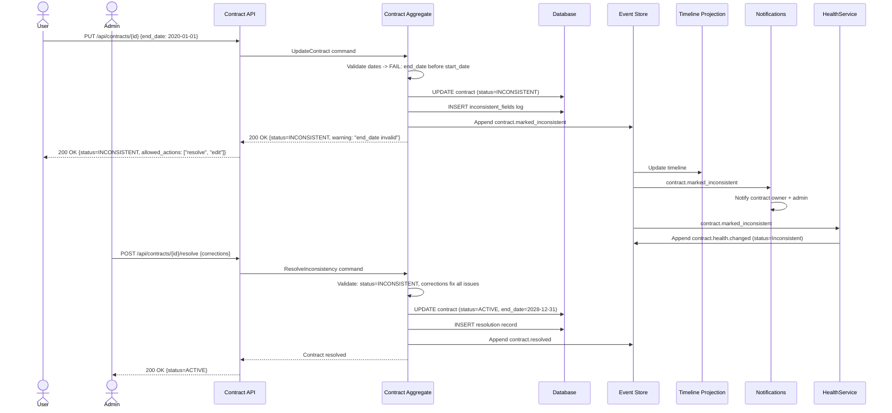
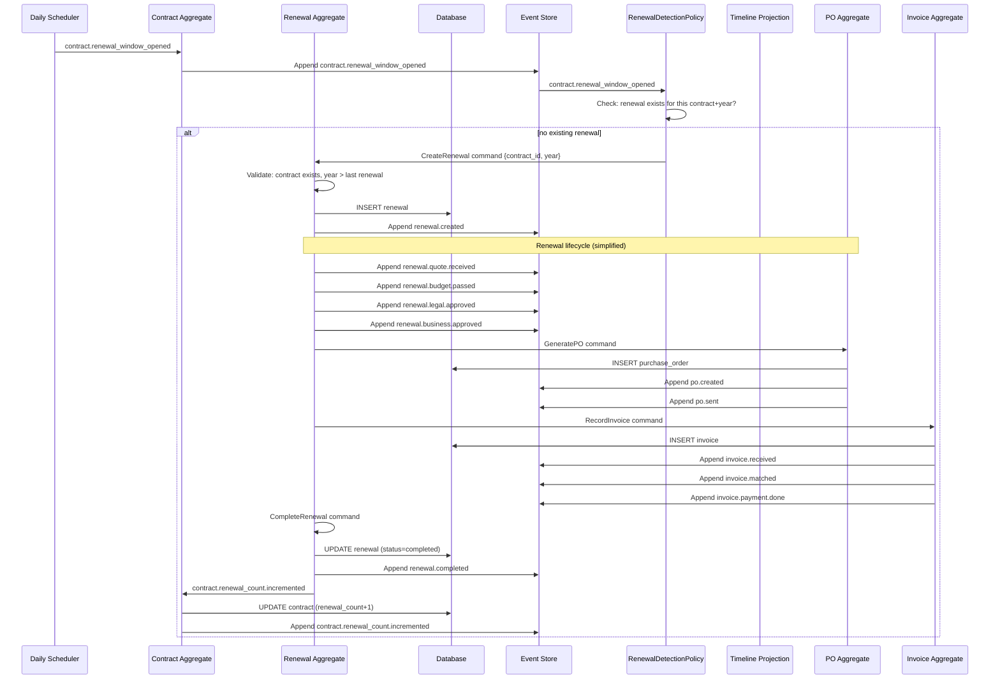
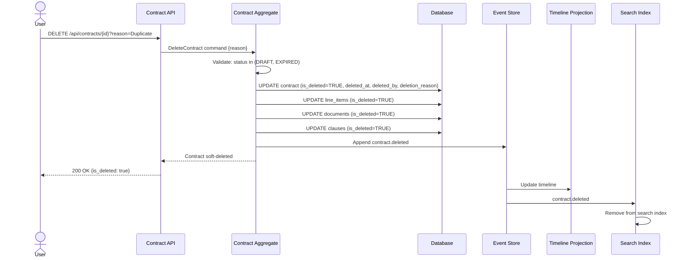

# Contract Aggregate — Sequence Diagrams

**Status:** Draft (Sprint 1)
**Date:** 2026-07-20
**Purpose:** 8 sequence diagrams covering all contract lifecycle flows. Each diagram shows commands, aggregate validation, events, policies, and downstream effects.

---

## Diagram 1: Contract Creation → Activation

The happy path: user creates a draft contract, fills in details, then activates it.

---

## Diagram 2: Contract Amendment (During ACTIVE)

User modifies an active contract. The system snapshots the previous state and emits an amendment event.

---

## Diagram 3: Contract Termination

User terminates an active contract. System validates reason, records termination, and cancels pending renewals.

---

## Diagram 4: Contract Expiry (Scheduler-Detected)

The daily scheduler checks all ACTIVE contracts whose end_date has passed, marks them as expired.

---

## Diagram 5: Contract Archival

User archives an expired or terminated contract. System sets retention and prevents any further modifications.

---

## Diagram 6: Inconsistency Detection → Resolution

System detects a data integrity violation (e.g., end_date before start_date after an update). Contract enters INCONSISTENT state. Admin resolves it.

---

## Diagram 7: Contract → Renewal (Window Opens → Renewal Created)

The full cross-aggregate flow from contract renewal window detection through renewal completion and contract update.

---

## Diagram 8: Contract Deletion (Soft Delete)

User deletes a contract. System validates it's in DRAFT or EXPIRED status, soft-deletes it, and updates search index.

